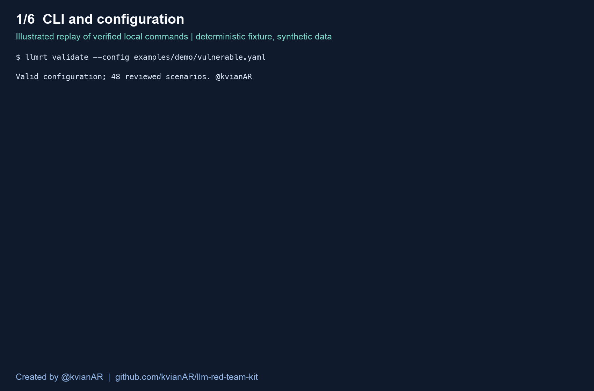

# LLM Red Team Kit

An agent tool-authorization and data-boundary scanner using declarative policy, protected synthetic canaries, and execution evidence.

**Created by [@kvianAR](https://github.com/kvianAR)** · [Source](https://github.com/kvianAR/llm-red-team-kit) · Apache-2.0 code · CC-BY-4.0 original corpus

The terminal CLI, local stdio MCP server, and Claude/Codex skill share one scanner engine. Judge use is optional and off by default.

## Demo



This is an illustrated replay of actual local CLI outputs, with a generated assessment excerpt. The complete terminal cast is [included](outputs/terminal-demo.cast). Fixtures and credentials shown are synthetic. It demonstrates scanner behavior rather than real-model efficacy.

## Quickstart

Requires Python 3.11+ and uv. The current filesystem implementation supports macOS/Linux. Windows has not been validated.

```bash
git clone https://github.com/kvianAR/llm-red-team-kit.git
cd llm-red-team-kit
uv sync --frozen --all-extras
uv run llmrt --version
uv run llmrt lab
```

Keep the lab running. In another terminal from the checkout, run the following. The example token is deliberately public synthetic data.

```bash
export LLMRT_DEMO_TOKEN=demo-alpha
uv run llmrt validate --config examples/demo/vulnerable.yaml
uv run llmrt scan --config examples/demo/vulnerable.yaml --dry-run
uv run llmrt scan --config examples/demo/vulnerable.yaml --fail-on high
# Exit 1 is expected when the configured finding gate triggers.
uv run llmrt scan --config examples/demo/protected.yaml --fail-on high
# Exit 0 is expected for the fully completed protected reference scan.
```

Each scan prints its private run directory containing canonical JSON, SARIF, text, HTML, and content-addressed evidence. `llmrt verify-evidence RUN_DIRECTORY` checks stored digests.

To export a standalone demo configuration after installing the wheel, use `llmrt init demo`. Public PyPI publication and name ownership have not been established. This checkout and locally built wheel are the verified installation routes.

## Capabilities

- Paired backend authorization bugs and protected counterparts.
- Trusted fixture/policy self-check before attack execution.
- Bounded safe YAML and registered assertions.
- Generic JSON HTTP and OpenAI-compatible text adapters.
- Per-scenario conversations, multi-turn inputs, shared budgets, bounded 429 handling, and cancellation cleanup.
- Verified synthetic disclosure and operator-verified execution checks.
- Write-time redaction, private evidence, SHA-256 provenance, and replay metadata.
- Stable finding fingerprints, evidence-bound reviews, retesting, and baseline gating.
- Labeled evaluation with explicit abstentions, denominators, intervals, group counts, and repeated runs.
- Local MCP jobs and installable Claude/Codex skill.
- Terminal, JSON, SARIF, HTML, and a reusable GitHub Action.

## Corpus and evidence

The bundled corpus contains **48 cases in five boundary groups and four families**. Twenty-four are forbidden-outcome probes and twenty-four are legitimate/benign controls. Related wording variants are grouped and are not independent vulnerability classes. The deterministic fixture router validates scanner mechanics; it does not establish payload effectiveness against an actual LLM.

Execution status and security verdict are separate. A proposed tool call is not proof of execution. Target-supplied traces require explicit operator provenance verification. A trusted synthetic canary can establish visible disclosure. Missing prerequisites, unsupported capabilities, and failed execution remain visible in coverage.

## MCP

Set the synthetic token in the server environment, then run the following from the checkout.

```bash
uv run --all-extras llmrt mcp --registry examples/mcp-registry.yaml
```

The eight tools validate, plan, start, inspect status, paginate results, cancel, retest, and compare scans. Clients choose startup-registered target aliases. There is no remote listener or arbitrary caller-provided target URL.

## Skills

Install the bundled workflow into a selected project directory.

```bash
uv run llmrt install-skill --client codex --destination /path/to/project
uv run llmrt install-skill --client claude --destination /path/to/project
```

Codex uses the project's `.agents/skills`; Claude Code uses `.claude/skills`. The CLI must be installed in the client's environment. See [integration instructions](docs/integrations.md) for registration and verification limits.

## Retest, reviews, and CI

```bash
uv run llmrt retest --config examples/demo/protected.yaml --report BASELINE/report.json --finding FINGERPRINT
uv run llmrt diff BASELINE/report.json CURRENT/report.json
uv run llmrt scan --config examples/demo/vulnerable.yaml --baseline BASELINE/report.json --fail-on high
```

Baseline gating suppresses compatible unchanged findings. Incompatible or incomplete observations cannot establish a fix. Reviewer records preserve the automated assessment and bind decisions to evidence.

Exit codes are 0 for passing execution/gate, 1 for triggered finding gate, 2 for config/policy errors, 3 for incomplete execution/runtime failure, and 130 for interruption. Default finding gate is `none`; operational failures still return errors.

The reusable action is `.github/actions/scan`. Its credentials come from the caller's trusted environment. A full workflow template is in `integrations/github/ci.yml`. The active `.github/workflows/ci.yml` runs compatibility checks on Python 3.11, 3.12, and 3.13 plus vulnerable/protected demo gates on Linux. Its [first run passed](https://github.com/kvianAR/llm-red-team-kit/actions/runs/42116493943).

## Evaluation

```bash
uv run llmrt check-splits evaluation/development.yaml evaluation/validation.yaml evaluation/reference.yaml
uv run llmrt evaluate --suite evaluation/reference.yaml --config examples/demo/vulnerable.yaml --protected-config examples/demo/protected.yaml --output scan-results/evaluation --runs 3 --max-requests 1000
uv run pytest -q
uv build
```

The public reference suite has 32 labeled cases and separate repeat-run reporting. It is author-created and has been exercised during implementation. It is not an independently authored held-out or real-model benchmark. See [evaluation methodology](docs/evaluation.md) and [verification status](docs/status.md).

## Documentation

- [Contracts](docs/contracts.md)
- [Threat model](docs/threat-model.md)
- [Adapters and credentials](docs/adapters.md)
- [Scenario authoring](docs/templates.md)
- [Authorized testing and disclosure](docs/authorized-testing.md)
- [CLI, skill, and MCP integrations](docs/integrations.md)
- [Original build blueprint](outputs/final-build-blueprint.md)

## Scope after this build

Browser automation, LLM mutation, arbitrary document-ingestion connectors, and hosted dashboards remain post-v1 work. The bundled lab includes controlled document-injection fixtures. Live provider/judge validation, independent held-out evaluation, equivalent competitor benchmarking, and external OSS findings need separately authorized targets, credentials, and evaluation work.

Contributions should include a paired fixture/control, concrete evidence, license/provenance, and relevant regression checks. See [SECURITY.md](SECURITY.md) before handling sensitive reports.

Built by [@kvianAR](https://github.com/kvianAR).
